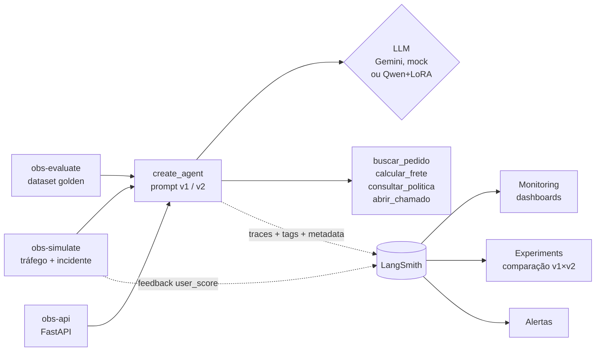
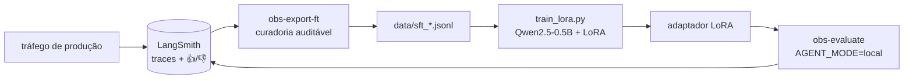

# Observabilidade de agentes LLM em produção — LangChain + LangSmith

Um agente de atendimento de e-commerce (LangChain `create_agent` + 4 ferramentas)
instrumentado para responder às perguntas que importam quando um agente está em
produção:

- **Está rápido?** latência p50/p99 por trace, por chamada de LLM e por ferramenta
- **Está quebrando?** taxa de erro do LLM e das ferramentas, separadas
- **Quanto custa?** tokens e US$ por conversa, por plano de cliente
- **Está ajudando?** 👍/👎 do usuário e "resolvido sem humano"
- **A mudança melhorou?** A/B entre duas versões de prompt, online e offline
- **O que aconteceu às 14h?** um incidente simulado visível nos gráficos

Tudo roda **sem custo de LLM**: o modo `mock` usa um chat model simulado que faz
tool calling, reporta tokens e se identifica como `gemini-3.8-flash`, então o
LangSmith calcula custo e latência como faria com o modelo real. Com uma
`GOOGLE_API_KEY` o mesmo código usa o Gemini de verdade.



## Como rodar

```bash
uv sync
```

```bash
cp .env.example .env
```

Preencha `LANGSMITH_API_KEY` no `.env` (conta gratuita em smith.langchain.com).
Deixe `GOOGLE_API_KEY` vazio para usar o modo mock.

```bash
uv run obs-ask "Qual o status do pedido 1002 e o frete para 30140-071?"
```

```bash
uv run obs-simulate --n 300 --duracao-min 40 --incidente
```

```bash
uv run obs-evaluate
```

`--duracao-min` espalha as conversas no tempo para que as séries temporais
tenham forma; `--incidente` degrada o sistema entre 40% e 65% da simulação
(latência ×4, transportadora com 45% de timeout, LLM com 12% de 503). Sem
LangSmith configurado, o simulador só imprime o resumo local.

## O que vai em cada trace

| Campo | Exemplo | Para que serve no dashboard |
| --- | --- | --- |
| `run_name` | `atendimento` | filtrar só as conversas (raiz) |
| `tags` | `prompt:v2`, `canal:whatsapp`, `simulacao` | filtros rápidos |
| `metadata.prompt_version` | `v1` / `v2` | **group by** para o A/B |
| `metadata.plano_cliente` | `free` / `plus` / `enterprise` | custo por segmento |
| `metadata.canal` | `web` / `whatsapp` / `app` | latência por canal |
| `metadata.categoria` | `pedido`, `frete`, `escalonamento`... | onde o agente erra |
| `metadata.app_version` | `1.3.0` | comparar releases |
| feedback `user_score` | 0 / 1 + comentário | satisfação |
| feedback `resolvido_sem_humano` | 0 / 1 | taxa de contenção |

O `run_id` é gerado antes do `invoke`, o que permite anexar o feedback do usuário
ao trace certo depois (`client.create_feedback(run_id, ...)`) — o mesmo padrão
de um botão 👍/👎 numa UI real.

## Montando os dashboards no LangSmith

**1. Monitoring pronto do projeto.** Em *Projects → agente-suporte-prod →
Monitoring* o LangSmith já mostra contagem de traces, latência, taxa de erro,
tokens, custo e feedback ao longo do tempo. O incidente aparece como um pico
simultâneo de latência e erros — este é o primeiro print do portfólio.

**2. Dashboard customizado** (*Monitoring → Dashboards → New dashboard*). Os
gráficos que contam a história:

| Gráfico | Métrica | Filtro | Agrupar por |
| --- | --- | --- | --- |
| Latência p50/p99 por prompt | Latency | run name = `atendimento` | metadata `prompt_version` |
| Custo por plano | Total cost | run name = `atendimento` | metadata `plano_cliente` |
| Satisfação A/B | Feedback `user_score` | — | metadata `prompt_version` |
| Contenção | Feedback `resolvido_sem_humano` | — | metadata `categoria` |
| Erros por ferramenta | Error rate | run type = `tool` | run name |
| Latência por ferramenta | Latency p99 | run type = `tool` | run name |
| Tokens por chamada de LLM | Tokens | run type = `llm` | metadata `prompt_version` |

O que esperar ver: a v2 (prompt com regras e limite de 3 frases) gasta menos
tokens de saída, responde mais rápido e tem `user_score` maior; `calcular_frete`
domina os erros de ferramenta; `escalonamento` puxa a contenção para baixo.

**3. Alertas** (*Projects → agente-suporte-prod → Alerts*): taxa de erro acima de
10% em 5 min, latência p99 acima de 8 s, ou `user_score` médio abaixo de 0,5. Rode
`obs-simulate --incidente` para dispará-los.

**4. Experimentos offline.** `obs-evaluate` cria o dataset `suporte-golden` (10
casos com ferramenta esperada e trecho obrigatório na resposta) e publica um
experimento por prompt, com os avaliadores `tool_correta`, `conteudo_esperado`,
`concisao`, `sem_erro` e o resumo `taxa_aprovacao`. Em *Datasets & Experiments →
suporte-golden* selecione os dois e clique em *Compare*.

## API (FastAPI)

```bash
uv run obs-api
```

Documentação interativa em http://127.0.0.1:8000/docs.

| Rota | O que faz |
| --- | --- |
| `POST /v1/chat` | resposta completa + `run_id`, tools usadas, tokens e latência |
| `POST /v1/chat/stream` | Server-Sent Events: `tool_call` → `tool_result` → `resposta` |
| `POST /v1/feedback` | 👍/👎 do usuário, anexado ao trace pelo `run_id` |
| `GET /health` | modo do LLM, modelo, tracing e versão |

- **A/B fixo por sessão:** sem `prompt_version`, a variante sai de um hash da
  `sessao`, então o mesmo cliente nunca vê o agente mudar de comportamento no
  meio da conversa. A `sessao` também vira `session_id` no LangSmith, que agrupa
  os traces em *Threads*.
- **Erro com rastreabilidade:** quando o LLM cai, a API devolve 503 com o
  `run_id`, e o suporte acha o trace exato da falha.
- **Server-Timing** em toda resposta, para ver a latência no DevTools do navegador.

Para gerar o tráfego pela API, como um cliente real faria:

```bash
CHAOS_ENDPOINT=true uv run obs-api
```

```bash
uv run obs-simulate --api-url http://127.0.0.1:8000 --n 200 --incidente
```

O endpoint `/_chaos` só existe com `CHAOS_ENDPOINT=true`; ele liga o incidente
dentro do processo da API.

## Confiabilidade: pass^k (τ-bench)

Acertar uma vez não basta para um agente em produção: o cliente seguinte faz a
mesma pergunta. O `obs-evaluate` roda cada caso do golden **k vezes** (padrão 3)
e publica, além das notas por caso, a métrica **pass^k** do τ-bench
([Yao et al., 2024, arXiv:2406.12045](https://arxiv.org/abs/2406.12045)): a
probabilidade de o agente acertar a mesma tarefa em *todas* as k tentativas.

Com n tentativas e c acertos por tarefa, o estimador não viesado é
`C(c, k) / C(n, k)`, com a média tomada sobre as tarefas
(`evaluate.py: pass_hat_k`). O pass@k pergunta "acerta alguma vez?"; o pass^k
pergunta "dá para confiar?". A distância entre pass^1 e pass^3 é a
inconsistência do agente: no mock, ela vem dos 503 aleatórios; com um LLM real,
vem também da variação das respostas.

```bash
uv run obs-evaluate --k 5 --prompts v2
```

## Data flywheel: produção → fine-tuning

O mesmo LangSmith que monitora a produção vira a fonte de dados de treino.



**1. Curadoria** (`flywheel.py`), em que cada critério é um filtro com contagem
de descartes:

- trace sem erro e sem falha de ferramenta;
- sem 👎 do usuário;
- só a variante de prompt vencedora (v2);
- **fora as perguntas do golden**, para a avaliação não medir memorização;
- deduplicado por (pergunta, sequência de tools).

Cada exemplo guarda o `run_id` de origem, então dá para voltar do dado de treino
ao trace.

```bash
uv run obs-export-ft --dias 7
```

**2. Treino LoRA** ([Hu et al., 2021](https://arxiv.org/abs/2106.09685)) num
modelo de 0,5B, que cabe numa GPU de notebook. A loss é calculada **só nos turnos
do assistente** (tool calls e resposta final). Prompt, pergunta e retorno das
ferramentas ficam mascarados (`-100`): treinar neles ensinaria o modelo a
inventar respostas de API.

```bash
uv sync --extra finetune
```

```bash
uv run python finetune/train_lora.py
```

**3. Avaliação no mesmo harness:** o `LocalChatModel` (`local_llm.py`) entra no
mesmo `create_agent`, com tool calling no formato Qwen. Base e LoRA viram
experimentos comparáveis com o Gemini no LangSmith.

```bash
AGENT_MODE=local LOCAL_MODEL=Qwen/Qwen2.5-0.5B-Instruct uv run obs-evaluate --prompts v2 --concorrencia 1
```

```bash
AGENT_MODE=local LOCAL_MODEL=finetune/adapters/qwen-suporte-lora uv run obs-evaluate --prompts v2 --concorrencia 1
```

### Resultados (RTX 4050 Laptop, 6 GB)

**Treino:** 64 exemplos de treino e 11 de validação, curados de cerca de 300
traces. 3 épocas em 18 min, com 8,8 M parâmetros treináveis (1,75% do modelo).
A loss de treino caiu de 0,55 para 0,13 e a de validação terminou em 0,004.
Essa loss de validação tão baixa reflete um professor de templates fixos (o
mock) e não prova generalização; quem prova é a avaliação abaixo.

**Avaliação no golden** (perguntas excluídas do treino, 3 repetições por caso,
prompt v2):

| Métrica | Qwen2.5-0.5B base | + LoRA |
| --- | --- | --- |
| `tool_correta` | 0,40 | **0,90** |
| `conteudo_esperado` | 0,47 | **0,80** |
| `concisao` | 0,90 | **1,00** |
| pass^1 | 0,27 | **0,70** |
| pass^3 | 0,20 | **0,70** |
| latência p50 | 4,0 s | 8,7 s |

Leitura honesta:

- **O ganho é de comportamento:** escolher a ferramenta certa subiu de 40% para
  90%.
- **pass^1 ≈ pass^3 não é mérito do modelo.** A geração é *greedy*
  (`do_sample=False`), então as repetições só variam com as falhas injetadas
  nas ferramentas.
- **O LoRA ficou mais lento porque o adaptador roda separado do modelo base.**
  Fundir com `merge_and_unload()` antes de servir elimina esse custo.
- **Em modo mock, o professor é o LLM simulado.** O que este projeto demonstra é
  o pipeline; com o Gemini faturado, os mesmos comandos destilam o Gemini.

## Testes

```bash
uv run pytest
```

Os testes rodam em modo mock, sem rede. Entre eles há uma regressão para o bug
de observabilidade descrito abaixo, além de testes da API (A/B fixo, 503 com
`run_id`, ordem dos eventos do stream), do pass^k e da conversão trace → exemplo
de treino.

## Estrutura

```
src/agent_observability/
├── agent.py      # create_agent + atender()/atender_stream(): run_id, tags e metadata
├── api.py        # FastAPI: chat, stream SSE, feedback, health
├── tools.py      # 4 ferramentas com latência e falhas injetadas
├── mock_llm.py   # chat model simulado (tool calling, tokens, ls_model_name)
├── local_llm.py  # chat model local (transformers + LoRA, tool calling Qwen)
├── chaos.py      # liga/desliga o "incidente"
├── simulate.py   # gerador de tráfego (em processo ou via HTTP) + feedback
├── evaluate.py   # dataset golden, avaliadores, pass^k, experimentos
├── flywheel.py   # traces curados → dataset de fine-tuning
├── config.py     # prompts v1/v2, modo do LLM, versão do app
└── cli.py        # obs-ask
finetune/train_lora.py   # LoRA com loss só nos turnos do assistente
tests/                   # pytest, modo mock, sem rede
```

## Decisões de design

- **Erros de ferramenta não derrubam a conversa, mas aparecem como erro.** O
  `ToolErrorMiddleware` devolve a `ToolException` ao modelo, que se desculpa; como
  a exceção sai da ferramenta antes, o run dela fica marcado como erro no trace.
  O atalho `handle_tool_error=True` faria o oposto: registraria a falha como
  sucesso e o gráfico de erros por ferramenta ficaria sempre zerado. Já o 503 do
  LLM derruba o trace inteiro, como em produção.
- **Metadata para agrupar, tags para filtrar.** Dimensões de baixa cardinalidade
  viram `metadata`; nunca colocar id de usuário ou texto livre em tag.
- **Mock fiel ao contrato, não ao conteúdo.** O mock não tenta ser inteligente;
  ele respeita o formato de tool calls, `usage_metadata` e `ls_model_name`, que é
  o que o LangSmith usa para métricas.
- **Um contrato, três modelos.** Mock, Gemini e o Qwen local implementam o mesmo
  `BaseChatModel`. Por isso simulador, API, avaliação e dashboards não sabem
  qual modelo está por trás.

## Como este projeto foi construído

Desenvolvido em par com o **Claude Code** (agente de código da Anthropic). Eu
direcionei o escopo e as decisões; o agente escreveu código, rodou os testes e
consultou as APIs reais do LangSmith e do Gemini para validar cada passo. Três
coisas que essa forma de trabalho pegou cedo:

- **Uma métrica que mentia.** O caminho óbvio, `handle_tool_error=True`, fazia
  toda falha de ferramenta ser registrada como *sucesso* no trace. Lendo o código
  do `langchain-core`, vimos que esse caminho chama `on_tool_end`, não
  `on_tool_error`. A troca pelo `ToolErrorMiddleware` hoje tem teste de regressão.
- **Uma comparação inválida.** A primeira avaliação v1 × v2 com o Gemini mostrava
  a v2 pior. Lendo os erros dos runs no LangSmith, eram 429 da cota diária do
  plano gratuito: a v2 rodou depois e pegou mais limite. O experimento foi
  descartado em vez de publicado como resultado.
- **Modelo aposentado.** O `gemini-2.5-flash` retornava 404 para contas novas; a
  lista de modelos da API definiu o substituto.
