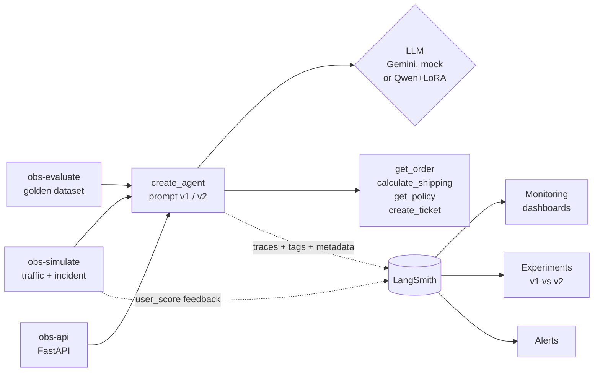
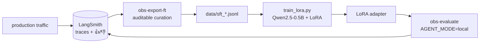

# Observability for LLM agents in production: LangChain + LangSmith

An e-commerce customer support agent (LangChain `create_agent` + 4 tools),
instrumented to answer the questions that matter once an agent is in production:

- **Is it fast?** p50/p99 latency per trace, per LLM call and per tool
- **Is it breaking?** LLM and tool error rates, tracked separately
- **What does it cost?** tokens and USD per conversation, per customer plan
- **Is it helping?** user 👍/👎 and "resolved without a human"
- **Did the change help?** A/B between two prompt versions, online and offline
- **What happened at 2 p.m.?** a simulated incident, visible in the charts
- **Can it get better?** production traces → fine-tuning dataset → LoRA

Everything runs **at zero LLM cost**: `mock` mode uses a simulated chat model that
does tool calling, reports tokens and identifies itself as `gemini-3.8-flash`, so
LangSmith computes cost and latency just as it would for the real model. With a
`GOOGLE_API_KEY` the same code runs on real Gemini.



## Getting started

```bash
uv sync
```

```bash
cp .env.example .env
```

Fill in `LANGSMITH_API_KEY` in `.env` (free account at smith.langchain.com).
Leave `GOOGLE_API_KEY` empty to use mock mode.

```bash
uv run obs-ask "What's the status of order 1002 and shipping to 30140-071?"
```

```bash
uv run obs-simulate --n 300 --duration-min 40 --incident
```

```bash
uv run obs-evaluate
```

`--duration-min` spreads conversations over time so the time-series charts have
shape; `--incident` degrades the system between 40% and 65% of the run (4x
latency, 45% carrier timeouts, 12% LLM 503s). Without LangSmith configured, the
simulator only prints the local summary.

## What goes into every trace

| Field | Example | What it's for in the dashboard |
| --- | --- | --- |
| `run_name` | `support-chat` | filter conversations only (root runs) |
| `tags` | `prompt:v2`, `channel:whatsapp`, `simulation` | quick filters |
| `metadata.prompt_version` | `v1` / `v2` | **group by** for the A/B |
| `metadata.customer_plan` | `free` / `plus` / `enterprise` | cost per segment |
| `metadata.channel` | `web` / `whatsapp` / `app` | latency per channel |
| `metadata.category` | `order`, `shipping`, `escalation`... | where the agent fails |
| `metadata.app_version` | `1.3.0` | compare releases |
| feedback `user_score` | 0 / 1 + comment | satisfaction |
| feedback `resolved_without_human` | 0 / 1 | containment rate |

The `run_id` is generated before `invoke`, so the user's feedback can later be
attached to the right trace (`client.create_feedback(run_id, ...)`), the same
pattern as a 👍/👎 button in a real UI.

## Building the LangSmith dashboards

**1. The project's built-in Monitoring.** *Projects → support-agent-prod →
Monitoring* already shows trace count, latency, error rate, tokens, cost and
feedback over time. The incident shows up as a simultaneous spike in latency and
errors.

**2. A custom dashboard** (*Monitoring → Dashboards → New dashboard*). The charts
that tell the story:

| Chart | Metric | Filter | Group by |
| --- | --- | --- | --- |
| p50/p99 latency per prompt | Latency | run name = `support-chat` | metadata `prompt_version` |
| Cost per plan | Total cost | run name = `support-chat` | metadata `customer_plan` |
| A/B satisfaction | Feedback `user_score` | — | metadata `prompt_version` |
| Containment | Feedback `resolved_without_human` | — | metadata `category` |
| Errors per tool | Error rate | run type = `tool` | run name |
| Latency per tool | Latency p99 | run type = `tool` | run name |
| Tokens per LLM call | Tokens | run type = `llm` | metadata `prompt_version` |

What to expect: v2 (a prompt with explicit rules and a 3-sentence limit) uses
fewer output tokens, answers faster and has a higher `user_score`;
`calculate_shipping` dominates tool errors; `escalation` drags containment down.

**3. Alerts** (*Projects → support-agent-prod → Alerts*): error rate above 10% over
5 min, p99 latency above 8 s, or average `user_score` below 0.5. Run
`obs-simulate --incident` to trigger them.

**4. Offline experiments.** `obs-evaluate` creates the `support-golden` dataset
(10 cases with the expected tools and a required snippet in the answer) and
publishes one experiment per prompt, with the evaluators `correct_tools`,
`expected_content`, `concise`, `no_error` and the summaries `pass_rate` and
`pass^k`. In *Datasets & Experiments → support-golden*, select two and click
*Compare*.

## API (FastAPI)

```bash
uv run obs-api
```

Interactive docs at http://127.0.0.1:8000/docs.

| Route | What it does |
| --- | --- |
| `POST /v1/chat` | full answer + `run_id`, tools used, tokens and latency |
| `POST /v1/chat/stream` | Server-Sent Events: `tool_call` → `tool_result` → `answer` |
| `POST /v1/feedback` | user 👍/👎, attached to the trace via `run_id` |
| `GET /health` | LLM mode, model, tracing and version |

- **Sticky A/B per session:** without `prompt_version`, the variant comes from a
  hash of `session`, so the same customer never sees the agent change behavior
  mid-conversation. `session` also becomes `session_id` in LangSmith, which groups
  traces into *Threads*.
- **Errors you can trace:** when the LLM is down, the API returns 503 with the
  `run_id`, so support can find the exact failed trace.
- **Server-Timing** on every response, to see latency in the browser DevTools.

To send the traffic through the API, like a real client would:

```bash
CHAOS_ENDPOINT=true uv run obs-api
```

```bash
uv run obs-simulate --api-url http://127.0.0.1:8000 --n 200 --incident
```

The `/_chaos` endpoint only exists with `CHAOS_ENDPOINT=true`; it turns the
incident on inside the API process.

## Reliability: pass^k (τ-bench)

Getting it right once isn't enough for an agent in production: the next customer
asks the same question. `obs-evaluate` runs every golden case **k times** (3 by
default) and publishes, besides the per-case scores, the **pass^k** metric from
τ-bench ([Yao et al., 2024, arXiv:2406.12045](https://arxiv.org/abs/2406.12045)):
the probability that the agent solves the same task in *all* k attempts.

With n attempts and c successes per task, the unbiased estimator is
`C(c, k) / C(n, k)`, averaged over tasks (`evaluate.py: pass_hat_k`). pass@k asks
"does it ever get it right?"; pass^k asks "can I rely on it?". The gap between
pass^1 and pass^3 is the agent's inconsistency: in mock mode it comes from the
random 503s; with a real LLM it also comes from answer variance.

```bash
uv run obs-evaluate --k 5 --prompts v2
```

## Data flywheel: production → fine-tuning

The same LangSmith that monitors production becomes the source of training data.



**1. Curation** (`flywheel.py`). Every criterion is a filter with a discard count:

- trace with no error and no tool failure;
- no user 👎;
- only the winning prompt variant (v2);
- **golden questions excluded**, so evaluation doesn't measure memorization;
- deduplicated by (question, tool sequence).

Every example keeps its source `run_id`, so you can go from a training example
back to its trace.

```bash
uv run obs-export-ft --days 7
```

**2. LoRA training** ([Hu et al., 2021](https://arxiv.org/abs/2106.09685)) on a
0.5B model, which fits on a laptop GPU. The loss is computed **only on assistant
turns** (tool calls and the final answer). The prompt, the question and the tool
results are masked (`-100`): training on them would teach the model to make up
API responses.

```bash
uv sync --extra finetune
```

```bash
uv run python finetune/train_lora.py
```

**3. Evaluation in the same harness:** `LocalChatModel` (`local_llm.py`) plugs into
the same `create_agent`, with Qwen-style tool calling. Base and LoRA become
experiments you can compare with Gemini in LangSmith.

```bash
AGENT_MODE=local LOCAL_MODEL=Qwen/Qwen2.5-0.5B-Instruct uv run obs-evaluate --prompts v2 --concurrency 1
```

```bash
AGENT_MODE=local LOCAL_MODEL=finetune/adapters/qwen-support-lora uv run obs-evaluate --prompts v2 --concurrency 1
```

### Results (RTX 4050 Laptop, 6 GB)

**Training:** 63 train and 11 validation examples, curated from 181 traces. 3
epochs in 9 min, 8.8 M trainable parameters (1.75% of the model). Training loss
went from 0.77 to 0.01 and validation loss from 0.09 to 0.02. A validation loss
that low reflects a teacher with fixed templates (the mock), not generalization;
the evaluation below is what counts.

**Golden-set evaluation** (questions excluded from training, 3 repetitions per
case, prompt v2):

| Metric | Qwen2.5-0.5B base | + LoRA |
| --- | --- | --- |
| `correct_tools` | 0.40 | **0.80** |
| `expected_content` | 0.55 | **0.60** |
| `concise` | 1.00 | 1.00 |
| pass^1 | 0.40 | **0.60** |
| pass^3 | 0.40 | **0.60** |
| p50 latency | 3.4 s | 8.5 s |

**What changed, case by case:**

- **The base model hallucinates.** On policy questions it doesn't call the tool
  and answers from memory ("returns within 7 days", while the real policy is 30).
- **LoRA learned to look things up first.** Returns, refunds and the cancelled
  order are now correct, grounded in the tool result.
- **LoRA's remaining failures are worth reading too:**
  - it called `create_ticket` without the required `summary` argument;
  - on an exchange question it called `calculate_shipping` with a **made-up** ZIP
    code;
  - on an angry complaint it looked up the order but didn't escalate to a human.

  These are exactly the kinds of errors that more (and more varied) escalation
  examples in the dataset would target.

**Reading it honestly:**

- **pass^1 = pass^3 here is not the model's merit.** Generation is greedy
  (`do_sample=False`), so the repetitions only vary with the failures injected
  into the tools.
- **LoRA is slower because the adapter runs separately from the base model.**
  Merging it with `merge_and_unload()` before serving removes that cost.
- **In mock mode the teacher is the simulated LLM.** What this project
  demonstrates is the pipeline; with Gemini billing enabled, the same commands
  distill Gemini.

For contrast, the mock agent itself (3 repetitions, with random 503s on):

| | pass^1 | pass^2 | pass^3 |
| --- | --- | --- | --- |
| mock + prompt v1 | 0.93 | 0.87 | 0.80 |
| mock + prompt v2 | 1.00 | 1.00 | 1.00 |

v1 is the more interesting row: 93% looks good, but only 80% of the tasks
succeed on all three attempts. That gap is what pass^k exists to expose.

## Tests

```bash
uv run pytest
```

Tests run in mock mode, with no network. They include a regression test for the
observability bug described below, plus tests for the API (sticky A/B, 503 with
`run_id`, stream event order), pass^k and the trace → training example conversion.

## Layout

```
src/agent_observability/
├── agent.py      # create_agent + handle_message()/handle_message_stream(): run_id, tags, metadata
├── api.py        # FastAPI: chat, SSE stream, feedback, health
├── tools.py      # 4 tools with injected latency and failures
├── mock_llm.py   # simulated chat model (tool calling, tokens, ls_model_name)
├── local_llm.py  # local chat model (transformers + LoRA, Qwen tool calling)
├── chaos.py      # turns the "incident" on and off
├── simulate.py   # traffic generator (in-process or over HTTP) + feedback
├── evaluate.py   # golden dataset, evaluators, pass^k, experiments
├── flywheel.py   # curated traces → fine-tuning dataset
├── config.py     # v1/v2 prompts, LLM mode, app version
└── cli.py        # obs-ask
finetune/train_lora.py   # LoRA with loss on assistant turns only
tests/                   # pytest, mock mode, no network
STUDY_GUIDE.md           # step-by-step guide to every concept in the project
```

## Design decisions

- **Tool errors don't kill the conversation, but they do show up as errors.**
  `ToolErrorMiddleware` hands the `ToolException` back to the model, which
  apologizes; since the exception leaves the tool first, the tool run is marked as
  an error in the trace. The `handle_tool_error=True` shortcut does the opposite:
  it records the failure as a success, and the errors-per-tool chart stays at zero
  forever. An LLM 503, on the other hand, fails the whole trace, as in production.
- **Metadata to group, tags to filter.** Low-cardinality dimensions go into
  `metadata`; never put user ids or free text into a tag.
- **The mock is faithful to the contract, not the content.** It doesn't try to be
  smart; it respects the tool-call format, `usage_metadata` and `ls_model_name`,
  which is what LangSmith uses for metrics.
- **One contract, three models.** Mock, Gemini and the local Qwen all implement
  the same `BaseChatModel`, so the simulator, API, evaluation and dashboards don't
  know which model is behind them.

## How this project was built

Built in pair with **Claude Code** (Anthropic's coding agent). I drove the scope
and the decisions; the agent wrote code, ran the tests and queried the real
LangSmith and Gemini APIs to validate each step. Three things this way of working
caught early:

- **A metric that lied.** The obvious path, `handle_tool_error=True`, recorded
  every tool failure as a *success* in the trace. Reading the `langchain-core`
  source showed that this path calls `on_tool_end`, not `on_tool_error`. Switching
  to `ToolErrorMiddleware` now has a regression test.
- **An invalid comparison.** The first v1 vs. v2 evaluation on Gemini showed v2 as
  worse. Reading the run errors in LangSmith, they were 429s from the free tier's
  daily quota: v2 ran second and got throttled more. The experiment was discarded
  instead of being published as a result.
- **A retired model.** `gemini-2.5-flash` returned 404 for new accounts; the API's
  model list determined the replacement.
